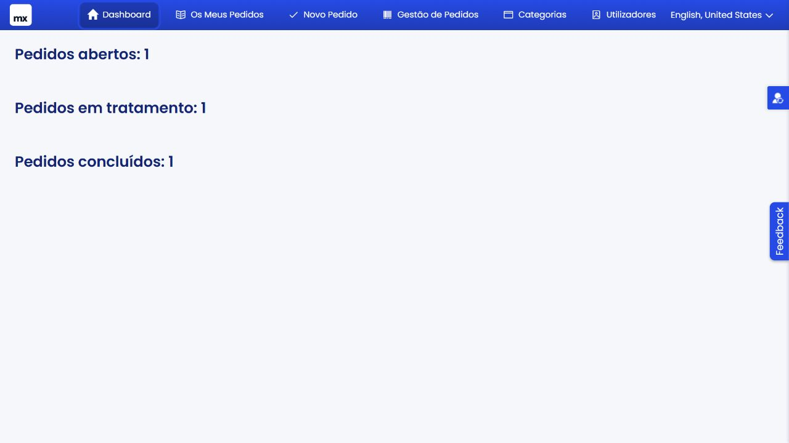
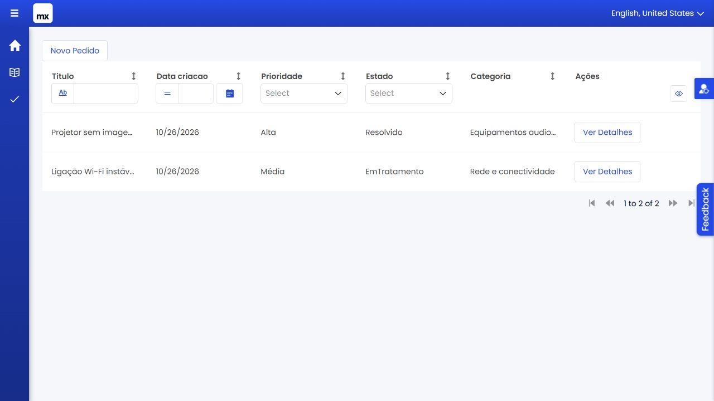
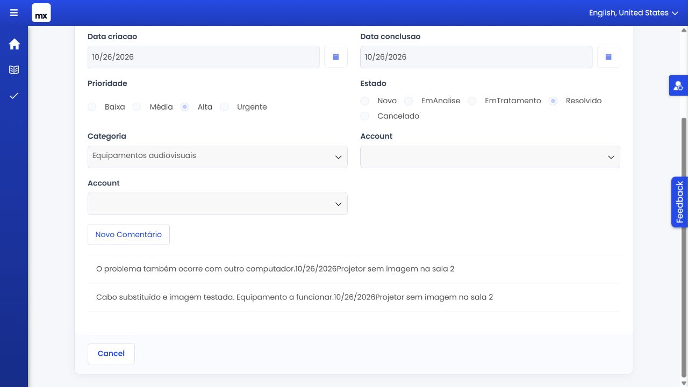
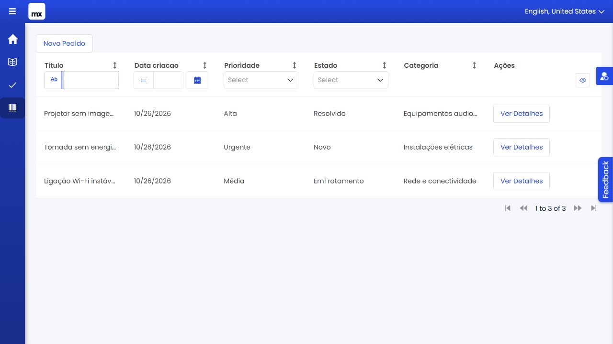
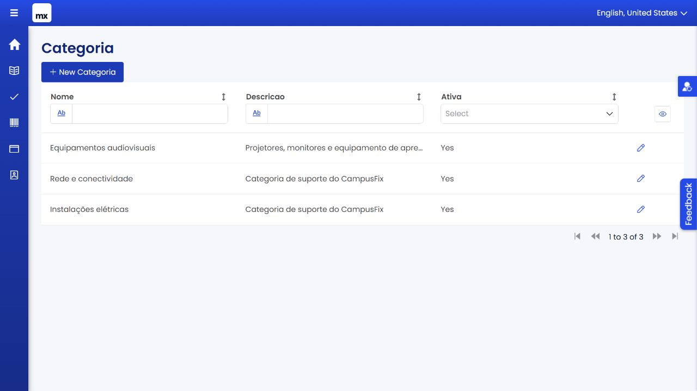

# CampusFix — Capturas de ecrã para entrega

Capturas reais da aplicação, recolhidas em 26 de outubro de 2026 numa cópia isolada, com dados fictícios. São cinco imagens, dentro do intervalo pedido no enunciado.

## 1. Dashboard

Perfil Administrador. Indicadores globais: um pedido aberto, um em tratamento e um concluído.

## 2. Os Meus Pedidos

Perfil Utilizador, conta demo_user. A lista contém apenas os pedidos do projetor e do Wi-Fi. O pedido da tomada, criado por demo_utilizador2, não aparece.

## 3. Detalhe de pedido concluído

Perfil Utilizador, conta demo_user. A captura foi deslocada para mostrar em conjunto a data de conclusão, o estado Resolvido e os dois comentários do pedido Projetor sem imagem na sala 2. Os campos estão desativados.

## 4. Área do técnico

Perfil Técnico. A lista de tratamento mostra os três pedidos, nos estados Novo, EmTratamento e Resolvido. A pesquisa foi testada por Wi-Fi e limpa antes da captura.

## 5. Administração de categorias

Perfil Administrador. A lista mostra as categorias criadas e a categoria Equipamentos audiovisuais depois de editada e guardada.

